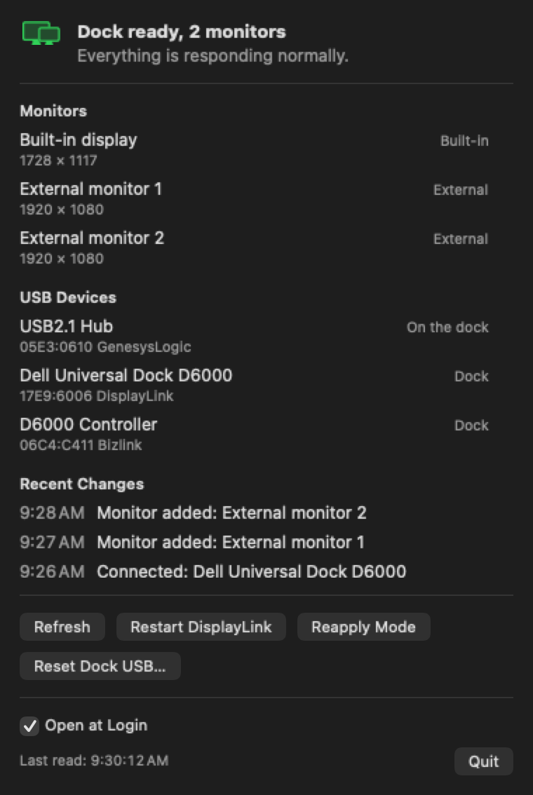
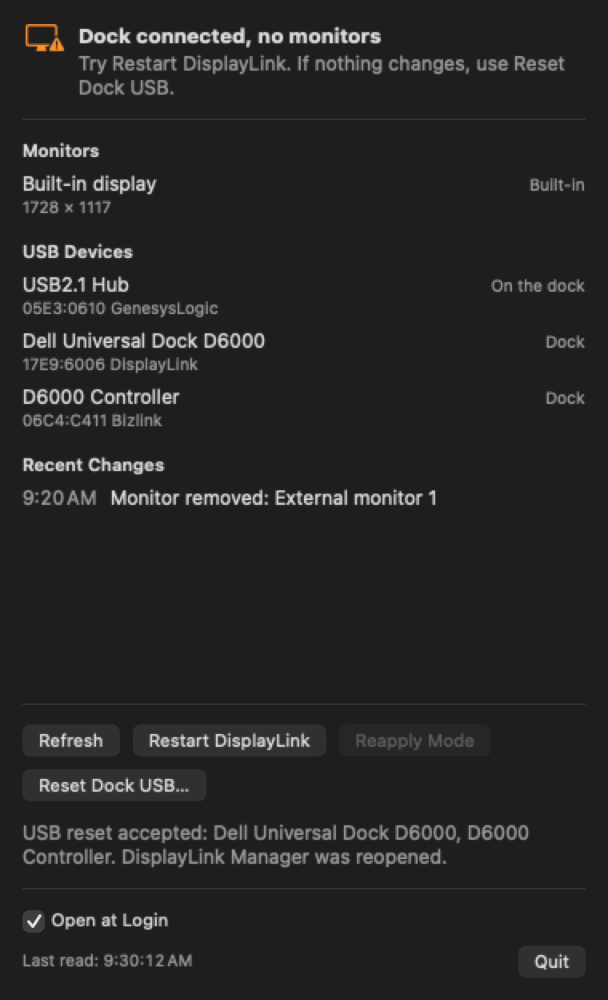
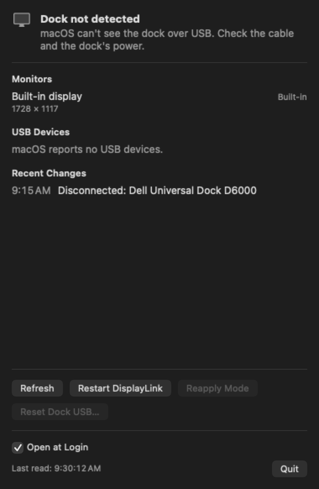

# D6000 Manager

**English** | [Español](README.es.md)

A macOS menu bar app that shows the status of a **Dell Universal Dock D6000** and helps you recover when your Mac stops recognizing the dock or its monitors.

The D6000 drives its monitors through DisplayLink, so several parts are involved on a Mac: the cable, the dock, DisplayLink Manager and macOS. D6000 Manager shows which one appears to be failing and puts the recovery actions in one place.

<p>
  
</p>

> The screenshots show the app's real interface with sample data.

## Features

- **Menu bar status:** the icon changes with the dock's status.
- **Monitors:** lists the displays connected to macOS and their resolution.
- **USB devices:** lists what macOS sees over USB and marks what belongs to the dock.
- **Recent changes:** shows the last 5 USB, monitor and DisplayLink changes.
- **Live updates:** reacts when devices connect or disconnect, and also rereads the status every 5 seconds and when you open the menu.
- **Manual actions:** nothing runs on its own.
- **English and Spanish:** the app follows the macOS language and uses English for any other language. You can choose its language in System Settings > General > Language & Region > Applications.

## Statuses

| Status | What it means | What to try |
| --- | --- | --- |
| **Dock not detected** | macOS can't see the dock over USB. | Check the cable and the dock's power. |
| **DisplayLink Manager is not installed** | The program that runs the dock's monitors is missing. | Install DisplayLink Manager. |
| **DisplayLink Manager is closed** | The dock is connected, but its monitors can't work without that program. | Click **Restart DisplayLink**. |
| **Dock connected, no monitors** | Everything responds, but macOS has no external monitors. | Click **Restart DisplayLink** and, if nothing changes, **Reset Dock USB**. |
| **Dock ready** | The dock is connected and external monitors are present. | Nothing. |

<p>
  
  
</p>

## Actions

| Button | What it does | Effect |
| --- | --- | --- |
| **Refresh** | Rereads the status. | None. |
| **Restart DisplayLink** | Closes DisplayLink Manager, restarts its service and opens it again. Also opens it if it was closed. | The dock's monitors go dark briefly. |
| **Reapply Mode** | Reapplies the current resolution to the external monitors macOS already sees. It doesn't make new monitors appear and may have no effect. | May cause a flicker. |
| **Reset Dock USB** | Closes DisplayLink Manager, resets the USB connection of the "D6000" devices and reopens it. Asks for confirmation. | The dock's monitors, audio and network cut out for a few seconds. **Eject any drives connected to it first.** |

## Requirements

- A Mac running macOS 14 or later.
- [DisplayLink Manager](https://www.synaptics.com/products/displaylink-graphics/downloads/macos) installed.
- Xcode, to build the app. There is no prebuilt download.

It has only been tested on a MacBook Pro with an M3 Pro, macOS 27.0.1 and DisplayLink Manager 16.2.39.

## Installation

The app is signed locally (ad hoc), so it is meant to be built and installed on the same Mac.

```sh
git clone https://github.com/hgmancholam/dell-d6000-osx-manager.git
cd dell-d6000-osx-manager

xcodebuild build \
  -project D6000Manager.xcodeproj \
  -scheme D6000Manager \
  -configuration Release \
  -destination 'platform=macOS' \
  -derivedDataPath build

ditto "build/Build/Products/Release/D6000 Manager.app" "/Applications/D6000 Manager.app"
open "/Applications/D6000 Manager.app"
```

The first time it opens from `/Applications`, it turns on its own automatic startup. To change this, use the **Open at Login** checkbox in the menu. If macOS asks for approval, go to System Settings > General > Login Items.

To update it, close the app with **Quit** and repeat the commands.

## Setting up DisplayLink Manager

These two settings belong to DisplayLink Manager, not to D6000 Manager, which needs no special permissions:

1. **Screen recording:** turn it on in System Settings > Privacy & Security > Screen & System Audio Recording. DisplayLink Manager needs it to send the picture to the monitors.
2. **Automatic startup:** turn it on in System Settings > General > Login Items. Without it, the monitors don't work until you open the program.

## Troubleshooting

**The dock's LED is amber and the dock doesn't appear.** According to Dell's manual, amber means standby and white means normal operation. Do a full restart:

1. Disconnect the USB-C cable from the Mac, the dock's power, the monitors and other accessories.
2. Wait at least 30 seconds.
3. Connect the power using the original adapter and wait for the LED to settle.
4. Connect the USB-C cable to the Mac with nothing else on the dock. If that doesn't work, try another port and another cable.

To see whether the connection keeps dropping, run this command twice, a few seconds apart. If `ConnectionCount` climbs quickly on a port, the problem is physical or in the dock, not in the app:

```sh
ioreg -r -c AppleHPMInterfaceType10 -w0 -l | grep -E 'Port-USB-C@|"ConnectionCount"|"TransportsActive"'
```

**The dock works, but it's slow or the monitors cut out.** Check `TransportsActive` in the same command. If it shows `USB2` and not `USB3`, the dock is running at 480 Mb/s. Flip the USB-C connector or try a USB 3 cable rated for 5 Gb/s or more.

**A monitor turns on briefly and then goes off.** Wait a minute, because DisplayLink can take a while to recreate the monitor. If it doesn't come back, click **Restart DisplayLink** and connect the monitors one at a time.

**The USB reset is accepted, but no monitors appear.** The USB connection is fine and the problem is further along. Check the DisplayLink Manager settings, the input selected on each monitor, and the video cables or adapters.

**I want to see what the app logged.** In zsh, `log` is a built-in command, so use the full path:

```sh
/usr/bin/log show --last 15m --style compact --predicate 'subsystem == "com.hgmancholam.D6000Menu"'
```

## Limitations

- **Dock detection:** relies on DisplayLink's USB vendor ID (`17E9`) or the name "D6000". Other DisplayLink hardware would also show up as a dock.
- **"On the dock":** is an approximation, because it means the device shares a USB bus with the dock.
- **USB reset:** doesn't reach the dock's internal hub, which is reserved for Apple's driver. A mouse or other accessories connected to that hub aren't reset.
- **Physical faults:** no action replaces reconnecting the cable or the power when the dock doesn't respond.

## Development

```text
D6000Manager/
  D6000ManagerApp.swift       Menu bar entry point
  MenuContentView.swift       Panel interface
  DockStore.swift             App state, updates and running actions
  Models.swift                Models, dock identification and status logic
  HardwareScanner.swift       Reads USB (IOKit), monitors and DisplayLink
  SystemWatcher.swift         USB, monitor and sleep change notifications
  DockActions.swift           DisplayLink and USB restarts, and reapply mode
  LoginItem.swift             Automatic startup
  USBReset.c                  USB connection reset
  en.lproj/, es.lproj/        Interface text for each language
D6000ManagerTests/            Unit tests
project.yml                   Project definition for XcodeGen
```

Run the tests:

```sh
xcodebuild test -project D6000Manager.xcodeproj -scheme D6000Manager -destination 'platform=macOS' -derivedDataPath build
```

The Xcode project is generated from `project.yml`. If you add files or change that configuration, run `xcodegen generate` (requires [XcodeGen](https://github.com/yonaskolb/XcodeGen)).

To change interface text, edit both `Localizable.strings` files. The tests check that both have the same keys and format specifiers.

The app doesn't use App Sandbox, because it needs IOKit access and has to restart other processes.
