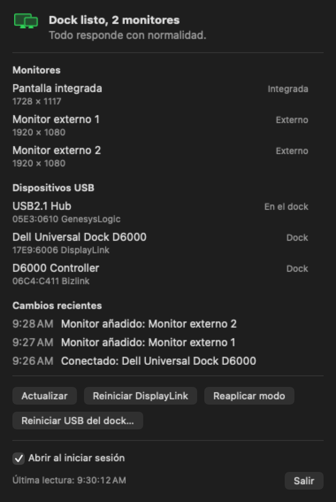
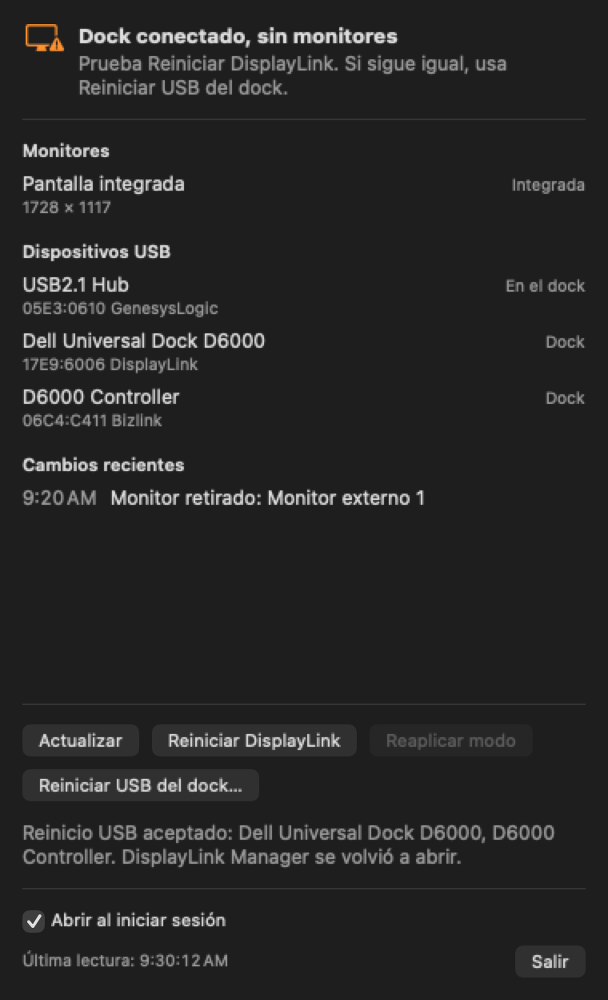
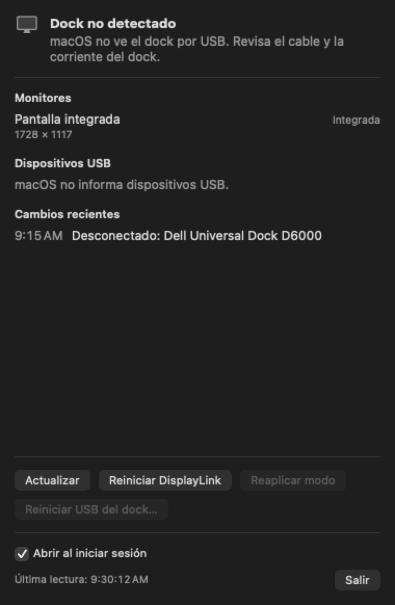

# D6000 Menu

App de barra de menú para macOS que muestra el estado de un dock **Dell Universal Dock D6000** y permite recuperarlo cuando el Mac deja de reconocerlo a él o a sus monitores.

El D6000 usa DisplayLink para sus monitores, así que en un Mac intervienen varias piezas: el cable, el dock, DisplayLink Manager y macOS. D6000 Menu indica cuál parece estar fallando y reúne en un solo lugar las acciones para reintentar.

<p>
  
</p>

> Los pantallazos muestran la interfaz real de la app con datos de ejemplo.

## Qué hace

- **Estado en la barra de menú:** el ícono cambia según el estado del dock.
- **Monitores:** lista las pantallas que macOS tiene conectadas y su resolución.
- **Dispositivos USB:** lista lo que macOS ve por USB y marca lo que pertenece al dock.
- **Cambios recientes:** muestra los 5 últimos cambios de USB, monitores y DisplayLink.
- **Actualización continua:** reacciona a conexiones y desconexiones, y además vuelve a leer el estado cada 5 segundos y al abrir el menú.
- **Acciones manuales:** ninguna se ejecuta sola.

## Estados

| Estado | Qué significa | Qué probar |
| --- | --- | --- |
| **Dock no detectado** | macOS no ve el dock por USB. | Revisa el cable y la corriente del dock. |
| **DisplayLink Manager no está instalado** | Falta el programa que controla los monitores del dock. | Instala DisplayLink Manager. |
| **DisplayLink Manager está cerrado** | El dock está conectado, pero sus monitores no pueden funcionar sin ese programa. | Pulsa **Reiniciar DisplayLink**. |
| **Dock conectado, sin monitores** | Todo responde, pero macOS no tiene ningún monitor externo. | Pulsa **Reiniciar DisplayLink** y, si sigue igual, **Reiniciar USB del dock**. |
| **Dock listo** | El dock está conectado y hay monitores externos. | Nada. |

<p>
  
  
</p>

## Acciones

| Botón | Qué hace | Efecto |
| --- | --- | --- |
| **Actualizar** | Vuelve a leer el estado. | Ninguno. |
| **Reiniciar DisplayLink** | Cierra DisplayLink Manager, reinicia su servicio y lo abre de nuevo. También sirve para abrirlo si estaba cerrado. | Los monitores del dock se apagan un momento. |
| **Reaplicar modo** | Vuelve a aplicar la resolución actual a los monitores externos que macOS ya ve. No hace aparecer monitores nuevos y puede no tener efecto. | Puede causar un parpadeo. |
| **Reiniciar USB del dock** | Cierra DisplayLink Manager, reinicia la conexión USB de los dispositivos "D6000" y vuelve a abrirlo. Pide confirmación. | Se cortan unos segundos los monitores, el audio y la red del dock. **Expulsa antes los discos conectados a él.** |

## Requisitos

- Mac con macOS 14 o posterior.
- [DisplayLink Manager](https://www.synaptics.com/products/displaylink-graphics/downloads/macos) instalado.
- Xcode, para compilar la app. No hay una versión ya compilada para descargar.

Solo se ha probado en un MacBook Pro con M3 Pro, macOS 27.0.1 y DisplayLink Manager 16.2.39.

## Instalación

La app está firmada localmente (ad hoc), así que está pensada para compilarla e instalarla en el mismo Mac.

```sh
git clone https://github.com/hgmancholam/dell-d6000-osx-manager.git
cd dell-d6000-osx-manager

xcodebuild build \
  -project D6000Menu.xcodeproj \
  -scheme D6000Menu \
  -configuration Release \
  -destination 'platform=macOS' \
  -derivedDataPath build

ditto build/Build/Products/Release/D6000Menu.app /Applications/D6000Menu.app
open /Applications/D6000Menu.app
```

La primera vez que se abre desde `/Applications`, activa su inicio automático. Para cambiarlo, usa la casilla **Abrir al iniciar sesión** del menú. Si macOS pide autorización, ve a Ajustes del Sistema > General > Ítems de inicio.

Para actualizarla, cierra la app con **Salir** y repite los comandos.

## Configurar DisplayLink Manager

Estos dos ajustes pertenecen a DisplayLink Manager, no a D6000 Menu, que no necesita permisos especiales:

1. **Grabación de pantalla:** actívala en Ajustes del Sistema > Privacidad y seguridad > Grabación de pantalla y audio del sistema. DisplayLink Manager la necesita para enviar la imagen a los monitores.
2. **Inicio automático:** actívalo en Ajustes del Sistema > General > Ítems de inicio. Sin él, los monitores no funcionan hasta que abras el programa.

## Solución de problemas

**El LED del dock está en ámbar y no aparece.** Según el manual de Dell, ámbar significa reposo; blanco es funcionamiento normal. Haz un reinicio completo:

1. Desconecta el USB-C del Mac, la corriente del dock, los monitores y los demás accesorios.
2. Espera al menos 30 segundos.
3. Conecta la corriente con el adaptador original y espera a que el LED se estabilice.
4. Conecta el USB-C al Mac, sin nada más en el dock. Si no funciona, prueba otro puerto y otro cable.

Para ver si la conexión se está cayendo en bucle, ejecuta este comando dos veces con unos segundos de diferencia. Si `ConnectionCount` sube rápido en un puerto, el problema es físico o del dock, no de la app:

```sh
ioreg -r -c AppleHPMInterfaceType10 -w0 -l | grep -E 'Port-USB-C@|"ConnectionCount"|"TransportsActive"'
```

**El dock funciona, pero va lento o los monitores se cortan.** Con el mismo comando, mira `TransportsActive`. Si muestra `USB2` y no `USB3`, el dock va a 480 Mb/s. Gira el conector USB-C o prueba un cable USB 3 de 5 Gb/s o más.

**Un monitor enciende un momento y se apaga.** Espera un minuto: DisplayLink puede tardar en volver a crear el monitor. Si no regresa, pulsa **Reiniciar DisplayLink** y conecta los monitores de uno en uno.

**El reinicio USB se acepta, pero no aparecen monitores.** La conexión USB está bien y el problema está más adelante. Revisa los ajustes de DisplayLink Manager, la entrada seleccionada en cada monitor, y los cables o adaptadores de video.

**Quiero ver qué registró la app.** En zsh, `log` es un comando interno, así que hay que usar la ruta completa:

```sh
/usr/bin/log show --last 15m --style compact --predicate 'subsystem == "com.hgmancholam.D6000Menu"'
```

## Limitaciones

- **Detección del dock:** se basa en el fabricante USB de DisplayLink (`17E9`) o en el nombre "D6000". Otro equipo DisplayLink también se mostraría como dock.
- **"En el dock":** es una aproximación, porque indica que el dispositivo comparte bus USB con el dock.
- **Reinicio USB:** no llega al hub interno del dock, que está reservado para el driver de Apple. El ratón u otros accesorios conectados a ese hub no se reinician.
- **Fallos físicos:** ninguna acción sustituye a reconectar el cable o la corriente cuando el dock no responde.

## Desarrollo

```text
D6000Menu/
  D6000MenuApp.swift     Punto de entrada de la barra de menú
  MenuContentView.swift  Interfaz del panel
  DockStore.swift        Estado de la app, actualización y acciones en curso
  Models.swift           Modelos, identificación del dock y cálculo del estado
  HardwareScanner.swift  Lectura de USB (IOKit), monitores y DisplayLink
  SystemWatcher.swift    Avisos de cambios de USB, monitores y reposo
  DockActions.swift      Reinicios de DisplayLink y USB, y reaplicar modo
  LoginItem.swift        Inicio automático
  USBReset.c             Reinicio de la conexión USB
D6000MenuTests/          Pruebas unitarias
project.yml              Definición del proyecto para XcodeGen
```

Ejecutar las pruebas:

```sh
xcodebuild test -project D6000Menu.xcodeproj -scheme D6000Menu -destination 'platform=macOS' -derivedDataPath build
```

El proyecto de Xcode se genera desde `project.yml`. Si añades archivos o cambias esa configuración, ejecuta `xcodegen generate` (requiere [XcodeGen](https://github.com/yonaskolb/XcodeGen)).

La app no usa App Sandbox, porque necesita acceder a IOKit y reiniciar otros procesos.
